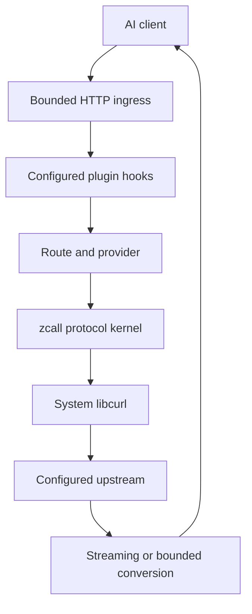

# Architecture and operating contract

## Small core, explicit extensions

zcalld accepts a local HTTP request, reads its public model name, applies configured routing hooks, selects a provider, and asks zcall to prepare the upstream call. A fixed worker owns its HTTP connection, libcurl handle and native plugin instances until the request finishes. Model aliases and policy are separately built libraries.

The Rust runtime dependencies are zcall, zconv, zplugin and the local SDK. zconv is already zcall's pinned protocol dependency; zcalld uses its JSON parser for borrowed routing inspection. zplugin's procedural macro dependencies run at build time. TLS, DNS and HTTP transport use the distribution's shared libcurl rather than a per-request executable.

## Request lifecycle

1. Parse bounded HTTP framing, rejecting duplicate headers, conflicting lengths and unsupported encodings.
2. Authenticate the local token when configured. Loopback listeners require a loopback Host; browser Origin requests are rejected.
3. Inspect JSON using borrowed token views and resolve plugin aliases/policies in declared order.
4. Select a named route and construct the upstream URL using zcall's `HttpEndpoint`.
5. Preserve the same-protocol request apart from model/stream edits, or convert through zcall with strict semantics.
6. Build upstream headers from the selected provider; consume local credentials at ingress.
7. Stream the response with bounded writes, or buffer only a cross-protocol non-streaming response within its cap.
8. Report status, duration and body-byte counts to configured observation hooks.

No prompts, keys or response bodies are written to the daemon's normal log. Plugin code is trusted native code and can use the host process's privileges. Hook arguments exclude provider credentials, but native loading itself is not a security sandbox.

## Supported conversion boundaries

The six zcall protocols have request, complete-response and stream adapters. Support means preserving semantics representable by both selected formats. It does not imply every source feature can be expressed by every target.

Same-protocol forwarding retains unknown provider JSON fields. Cross-protocol conversion uses the default strict zcall policy: opaque context, provider-specific extensions, item IDs, timestamp fields and reasoning distinctions must be representable or explicitly supplied by gateway context. A format requiring unavailable initial usage can reject a stream before any upstream request is made. The gateway does not invent usage or silently discard reasoning to make a conversion appear successful.

The test suite covers all six simple request and complete-response formats, Anthropic-to-Chat streaming text and tool calls, Chat-to-Responses streaming, fragmented UTF-8, truncated input, exact large integer preservation and unsupported-loss errors. Provider-specific behavior beyond those contracts requires corresponding fixtures.

## Bounds and concurrency

| Resource | Default / limit |
| --- | --- |
| Worker count | 4; configurable 1–64 |
| Queued connections | 16; configurable 0–1024 |
| Worker stack address space | 2 MiB per thread; committed RSS measured separately |
| Request line | 2 KiB |
| HTTP headers | 16 KiB, at most 64 fields |
| Request body | 4 MiB default, 16 MiB configuration ceiling |
| Response body | 16 MiB default and ceiling |
| Header/body receive deadline | 10 seconds default |
| Upstream connection timeout | 10 seconds default |
| Total upstream timeout | 300 seconds default |
| Downstream blocked write | 2 seconds per write, with shutdown checks between partial writes |
| Cross-protocol SSE frame/payload | 64 KiB |
| Cross-protocol SSE aggregate/pending regions | 256 KiB each |
| Native plugin count/config | 32 plugins; 64 KiB configuration per plugin |

Long generations occupy workers. Raising `workers` increases active concurrency and the possible aggregate working set. The acceptor and workers are fixed; the gateway does not create one thread for every request. Queued sockets have not yet allocated request-body buffers. Conversion temporarily retains source and target buffers, so active-request RSS is higher than idle RSS.

## Transport and failure semantics

libcurl connection caches are per worker. Request upload uses read/seek callbacks; the seek hook rejects rewinding after any upload bytes have been consumed. This prevents libcurl's reused-connection recovery from silently replaying a generation POST. No application retry or failover is performed. Upstream redirects are returned without following them or forwarding credentials to a new location.

Same-protocol and error bodies use fresh downstream framing. Upstream compressed responses are decoded by libcurl, so compressed Content-Length/Content-Encoding fields are not copied. Successful streaming responses end with a zero chunk. A transfer or conversion failure after headers leaves the stream incomplete, allowing clients to detect truncation. Status 204/304 responses are bodyless.

SIGINT and SIGTERM stop admission. Read loops, socket writes and libcurl progress callbacks check the stop flag. The service reports readiness only after listener and worker initialization, reports stopping, joins its workers and exits. Native plugins remain pinned until process exit; service restart applies updates.

## Sources

- [zcall contract](https://github.com/LIghtJUNction/zcall)
- [zplugin ABI and ownership](https://github.com/LIghtJUNction/zplugin)
- [libcurl upload rewind callback](https://curl.se/libcurl/c/CURLOPT_SEEKFUNCTION.html)
- [HTTP/1.1 framing, RFC 9112](https://www.rfc-editor.org/rfc/rfc9112.html)
- [systemd service notification](https://www.freedesktop.org/software/systemd/man/latest/systemd.service.html)
