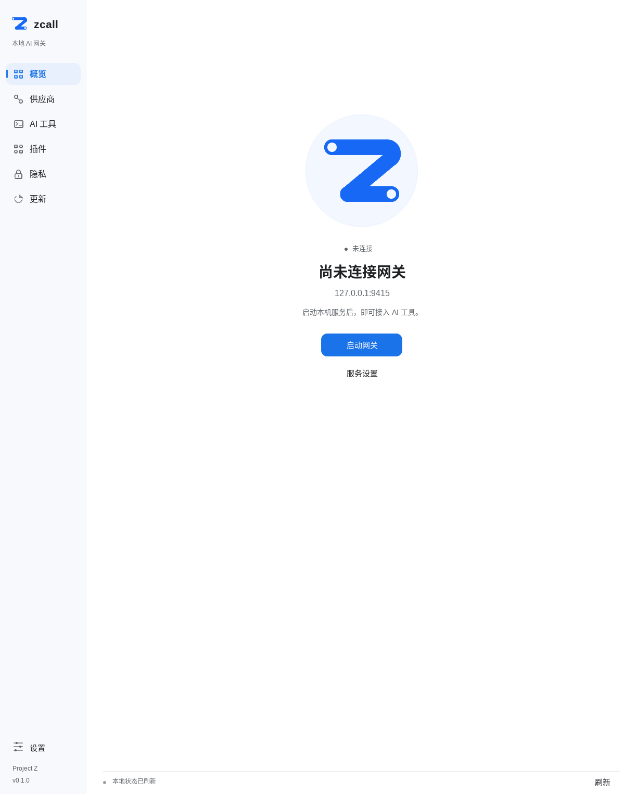

# zcall-gui 0.1.0 候选验收

本记录对应最终 GUI 源提交 [4d0267f229c3fea7277369e50404a455d8dabc06](https://github.com/LIghtJUNction/zcall-gui/commit/4d0267f229c3fea7277369e50404a455d8dabc06) 和 zui 子模块 [5e37fcfb791eec9ac523fc19373e95d0a513112f](https://github.com/LIghtJUNction/zui/commit/5e37fcfb791eec9ac523fc19373e95d0a513112f)。最终源码已完成本地检查和真实 Arch 源包构建。**截至本记录生成时，GUI 正式 tag、GitHub Release、AUR 发布和系统安装尚未执行**；正式发布仍须通过最终提交的五平台门禁，并等待 zcalld 0.2.0 满足运行依赖。

这里将最终源码检查、前一提交的原生候选、真实 Intel 测量分别列出。不同提交和不同图形驱动的结果不合并成同一次验证。

## 最终源码及隐私状态

最终提交通过 Rustfmt、Clippy（禁止警告）、15 项 GUI Rust 测试和 release 构建。随后在源包的独立解压树中再次执行构建及 check()：15 项 GUI 测试和 2 项 zui 测试全部通过。[源包记录](zcall-gui-4d0267f/source-package.json)

隐私页现在区分“已保存配置”和“运行状态”：

- 卡片始终标为“已保存”，不把保存动作描述为已经运行。
- 首次设置返回 restart_required=true 时，保留“启动或重启后生效”的提示，自动刷新不会将它覆盖。
- 服务操作依据实际命令参数识别，只有成功的 start/restart 才清除本次待重启标记；本地化的按钮文案不参与判断，失败保留错误和提示。
- 关闭后重开时，若核心报告 runtime_state=unknown 或没有提供该字段，页面明确显示“运行状态尚未确认”。服务在线本身不能证明新增隐私插件已加载。

对应回归包括设置后刷新、成功重启、重启失败，以及关闭后重开且服务在线但运行态未知。实现和测试见[最终 src/main.rs](https://github.com/LIghtJUNction/zcall-gui/blob/4d0267f229c3fea7277369e50404a455d8dabc06/src/main.rs)。在前一提交 90cedb0 上，私有 Xvfb 还完成了真实窗口点击：设置隐私 → 自动刷新 → 服务面板 → 中文确认重启 → 自动刷新。该测试只调用无副作用的 CLI fixture，没有操作宿主服务。[窗口操作记录](zcall-gui-4d0267f/privacy-window.json)

## 五平台原生候选

[候选运行 44636510212](https://github.com/LIghtJUNction/zcall-gui/actions/runs/44636510212) 对 **90cedb0** 与同一 zui 5e37fcf 执行检查，五个目标全部成功。它包含构建、测试、原生窗口启动及对应平台打包；Linux 还执行私有 Xvfb 交互和 X11 窗口属性回归。[机器可读结果](zcall-gui-4d0267f/native-candidate.json)

| 系统 | 目标 | 结果 |
|---|---|---|
| Ubuntu 24.04 | x86_64-unknown-linux-gnu | 通过 |
| Ubuntu 24.04 ARM | aarch64-unknown-linux-gnu | 通过 |
| Windows 2025 | x86_64-pc-windows-msvc | 通过 |
| macOS 15 | aarch64-apple-darwin | 通过 |
| macOS 15 Intel | x86_64-apple-darwin | 通过 |

Windows runner 的实际渲染器是 GDI Generic，两种 macOS runner 是 Apple Software Renderer。这些结果证明原生窗口路径可以运行，不能用来声称其硬件 GPU 性能。最终 4d0267f 在此基础上增加了“重开后运行态未知”的回归与界面提示；其正式发布仍执行新的五平台门禁。

## Intel GPU 下的本机观察

在真实 Hyprland/Xwayland 会话中运行 90cedb0 的本地 release 二进制，使用临时 HOME、独立配置和只读核心 CLI。测试没有修改全局显示环境、移动宿主指针或控制宿主服务；自己的 GUI 进程按限时参数退出。渲染器为 **Mesa Intel(R) UHD Graphics (ADL-S GT1)**。[原始测量](zcall-gui-4d0267f/hardware-intel.json)

| 指标 | 观测值 |
|---|---:|
| 实际平铺窗口 | 1224 × 1526 |
| 调用者指定最小尺寸 | 1080 × 740 |
| RSS | 61,968 KiB |
| PSS | 50,871 KiB |
| Private | 46,476 KiB |
| Swap | 0 |
| 空闲观察长度 | 4.001 秒 |
| 该窗口内 CPU tick 增量 | 0，系统时钟为 100 ticks/s |
| 12 秒进程生命周期内呈现次数 | 6 |
| 所测二进制大小 | 717,008 字节 |

RSS 是映射进程的驻留页总量；PSS 将共享页按使用者分摊；Private 是私有驻留页。这些数值来自 /proc/PID/smaps_rollup，**不包括完整的 GPU 分配和驱动显存**。四秒内未记录到 CPU tick 只说明这段观察中进程没有可计量的持续 CPU 工作，不能推导出任意负载、任意硬件下的长期占用。

该二进制 SHA256 为 fbbf26ae9f1e01a5d510a888466a6b6f99dc6c23bb336182ae0aaf637f75f0be。它对应 90cedb0，不是尚未发布的最终平台资产。也不将此前 llvmpipe 软件渲染测量与这次 Intel 结果混用。

## 最终 Arch 源包

2026-11-19 23:31 UTC，在 x86_64 Omarchy 4.5.0（Arch 系）上，用 rustc 1.100.0 构建最终 4d0267f 源码和精确的 zui 子模块。归档由已提交的 Git 文件生成，包含子模块，使用实际 SHA256 校验；没有 SKIP 校验值。[完整结果](zcall-gui-4d0267f/source-package.json)

| 文件 | 字节数 | SHA256 |
|---|---:|---|
| zcall-gui-v0.1.0-source.tar.gz | 387466 | 1aea5904be4bb53a5ef634cee296064e08b878a002690580c48a36112102fd7c |
| zcall-gui-0.1.0-1-x86_64.pkg.tar.zst | 536856 | 5fe9486e921c7e9ed418a43a8330e8ce4f36c18b9e44b13f2e265ed2fc112650 |

测试配方只把正式下载 URL 换成同名本地归档，其他构建、check 和安装树逻辑使用已提交的模板。生产配方与本地配方的 SRCINFO 分别和 makepkg 输出逐字比较。[生产配方](zcall-gui-4d0267f/PKGBUILD.release) · [生产 SRCINFO](zcall-gui-4d0267f/SRCINFO.release)

本次命令为 makepkg --cleanbuild --clean --nodeps --noconfirm，**没有 --install**。由于 zcalld>=0.2.0 当时尚未发布或安装，使用 --nodeps 跳过依赖满足性检查；这不等同于已验证正式 AUR 安装。build() 和 check() 仍完整运行，并使用 Cargo --frozen。配方保留 !lto，Rust 的 Cargo 构建配置不变。

包内可执行文件为 0755，版本输出正确；desktop 文件验证通过，图标、两个 MIT 许可证和文档路径齐全。namcap 没有 E 错误，仅有以下两条原文提示：[namcap 输出](zcall-gui-4d0267f/namcap.txt)

~~~text
zcall-gui W: Dependency included, but may not be needed ('zcalld')
zcall-gui W: Dependency included, but may not be needed ('curl')
~~~

这两个程序由 GUI 在运行时作为子进程调用，不能因为它们不出现在 ELF 链接依赖中就删除。构建 staging 和临时解包验证目录已清理；源码归档、配方、哈希记录及成包保存在开发机 apps/zcall-gui/_release/source-4d0267f/。该包使用本机 Arch 工具链；正式 Linux 二进制发行使用 Ubuntu 24.04 runner，二者的 libc 基线不得混淆。

## 共享库发布与后续门禁

zui-native 0.1.0 由 Project Z coordinator 发布。集成维护者随后直接下载注册表归档，核对 25,403 字节、SHA256 和 .cargo_vcs_info.json，确认源码为 5e37fcf；GUI 的子模块引用保持相同提交。[注册表校验回执](zcall-gui-4d0267f/zui-registry.json)

公开核心提交 [e116a54](https://github.com/LIghtJUNction/zcalld/commit/e116a543d8320a7a5b50f040bee9b03019ecba62) 中的 apps/zcall-gui 已通过 GitHub API 核对，指向最终 4d0267f。核心源码套件 → GUI → zui 的引用链已对齐。[引用和待收回执清单](zcall-gui-4d0267f/dependency-pins.json)

本记录闭合 GUI 自身的源码 pin、状态回归和源包构建验证。正式 GitHub/AUR 发布、依赖安装、系统服务切换，以及其他 zui 下游的传播回执仍由对应发布与集成步骤完成，不能从本记录提前推断为已完成。
